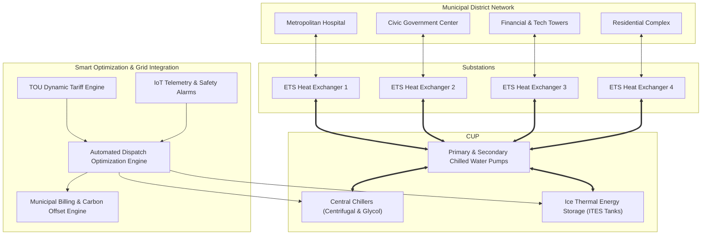

# System Architecture: Smart Municipal District Cooling & Ice Thermal Energy Storage (ITES)

## 1. Executive Summary
The **Smart Municipal District Cooling & Ice Thermal Energy Storage System** is a centralized utility platform designed to provide high-efficiency chilled water distribution across municipal zones (civic centers, hospitals, tech commercial towers, and residential complexes) coupled with thermal energy storage using latent heat of fusion of ice.

By utilizing **Ice Thermal Energy Storage (ITES)**, the plant generates and stores cooling in the form of ice during nighttime off-peak electricity hours (when power rates are lowest and ambient temperatures yield higher chiller efficiency). During peak afternoon daytime hours, the stored ice is melted (discharged) to satisfy district cooling demand, dramatically reducing peak grid demand charges and operating energy costs.

---

## 2. High-Level Architectural Flowchart

---

## 3. Core Thermal Loops

1. **Primary Refrigeration / Glycol Loop**:
   - Chiller units cool a 25% ethylene/propylene glycol brine mixture down to -4°C to -6°C during off-peak charging.
   - Brine circulates through internal heat-exchange tubes inside insulated ITES storage tanks, freezing surrounding water into ice.

2. **Secondary ITES Discharge Loop**:
   - During peak demand periods, warm chilled water returning from municipal zones passes through the ITES heat exchanger.
   - Ice melts at a steady 0°C latent fusion temperature, cooling water to supply temperatures (4.5°C to 5.5°C) without heavy compressor load.

3. **District Underground Distribution Loop**:
   - Insulated underground supply and return pipes distribute chilled water to municipal substations.
   - Energy Transfer Stations (ETS) isolate the municipal building secondary loops from the main district primary loop using high-efficiency plate-and-frame heat exchangers.

---

## 4. Software Package Organization (Package-by-Feature)

The application code inside `src/main/java/com/example/demo/` is organized by project domain features:

| Folder / Package | Responsibility |
|---|---|
| `chillerplant` | Centrifugal & dual-mode chiller staging, COP curves, compressor power tracking |
| `icestorage` | ITES tank management, ice charge/melt cycle control, state-of-charge (SOC %) |
| `districtcooling` | Municipal zones, cooling load demand aggregation, substations (ETS), delta-T monitoring |
| `energytariff` | Time-of-Use (TOU) electricity schedules, peak demand penalty avoidance |
| `smartdispatch` | Real-time optimization algorithm for chiller vs ice melt power dispatch |
| `iottelemetry` | Real-time sensor stream ingestion, anomaly detection, safety alerts |
| `municipalbilling` | Zone energy consumption metering, monthly district cooling bills, CO2 reduction tracking |
| `systemconfig` | Spring Security, CORS filter, automated data initialization |
